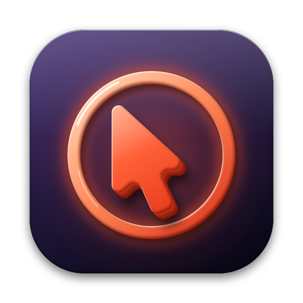
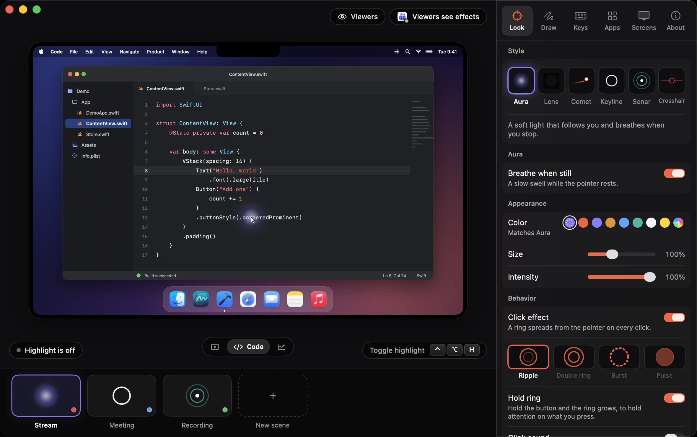
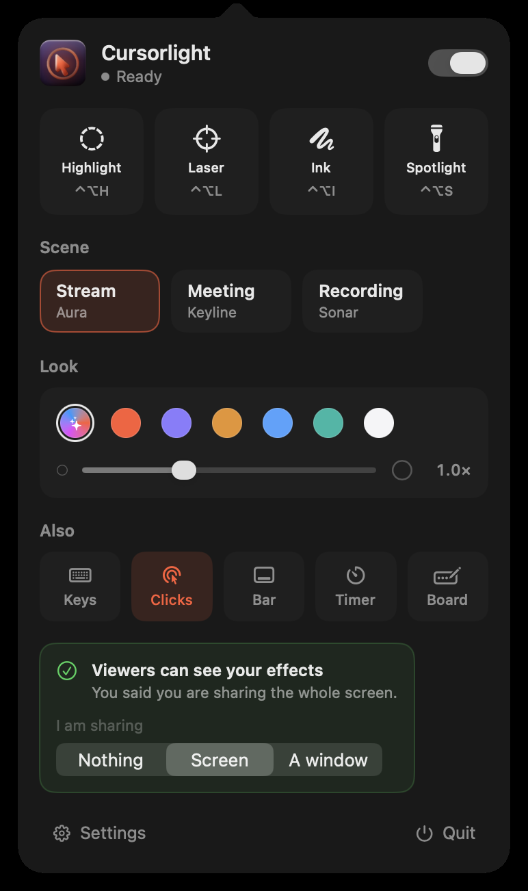
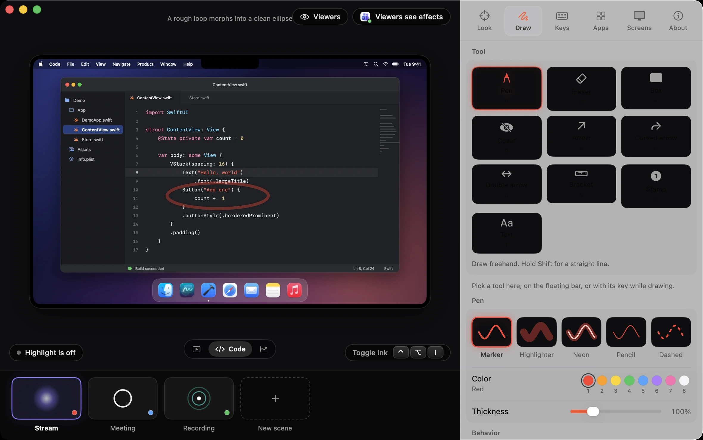
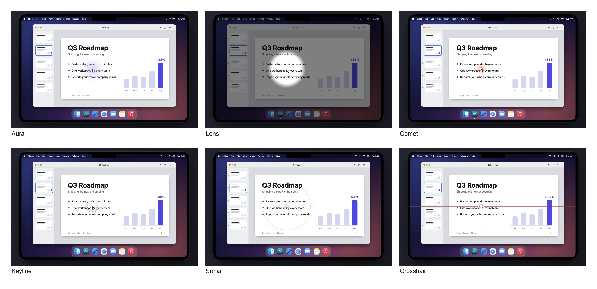
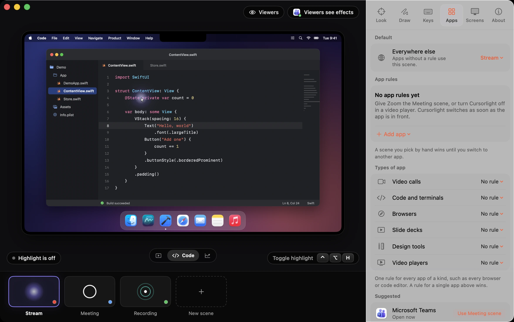
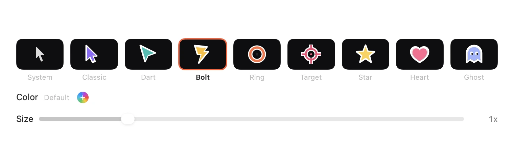
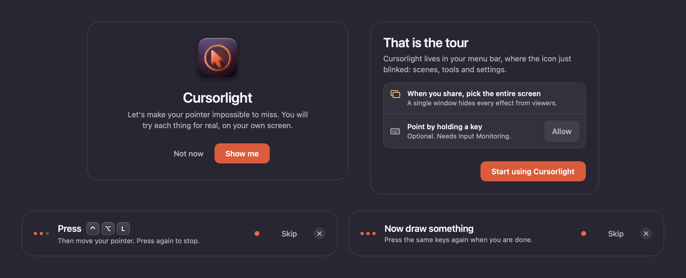

<div align="center">



# Cursorlight

**Be seen wherever you point.**<br>
Find your pointer, point with a laser, draw on the screen and spotlight a region,<br>
while you share your screen or present. A free menu bar app for the Mac.

[](https://github.com/Zawalid/Cursorlight/releases/latest)
[](https://github.com/Zawalid/Cursorlight/actions/workflows/ci.yml)
[](LICENSE)


[Website](https://cursorlight.zawalid.com) &nbsp;·&nbsp; [Download](https://github.com/Zawalid/Cursorlight/releases/latest) &nbsp;·&nbsp; [Install guide](docs/install.md) &nbsp;·&nbsp; [Sharing honestly](#sharing-honestly) &nbsp;·&nbsp; [Privacy](#privacy) &nbsp;·&nbsp; [Build from source](#build-from-source) &nbsp;·&nbsp; [Roadmap](docs/ROADMAP.md)

<br>

<picture>
  <source media="(prefers-color-scheme: dark)" srcset="docs/images/overview-dark.webp">
  
</picture>

</div>

<br>

## Why

On a call or a recording, people lose your pointer. It is small, it hides in a busy window, and nothing tells them
where you are looking. You end up saying "no, to the left" over and over.

Cursorlight puts a light on your pointer when you want it, and takes it away when you do not. Shake the mouse and a soft
glow finds your cursor. Press a key and a laser trail follows it. Draw an arrow, circle a number, then let the ink fade.
It lives in the menu bar, works in every app, and needs no permission to start.

## Features

<table>
<tr>
<td width="50%" valign="top">

**Highlight**<br>
Six styles: Aura, Lens, Comet, Keyline, Sonar and Crosshair. Pick a color and a size, and add click effects that ripple
from the pointer. Shake the mouse to turn it on, shake again to turn it off.

</td>
<td width="50%" valign="top">

**Laser and ink**<br>
A laser with a trail, and a pen with five looks, arrows, boxes, text, stamps and a whiteboard. Rough shapes snap to clean
ones. Strokes fade by themselves, or stay until you clear them.

</td>
</tr>
<tr>
<td width="50%" valign="top">

**Spotlight**<br>
Light one region of the screen and dim the rest, while clicks still reach what is inside. Good for a table, a chart or a
line of code.

</td>
<td width="50%" valign="top">

**Pointer skins**<br>
Replace the real pointer with a design of its own: Classic, Dart, Bolt, Ring, Target, Star, Heart or Ghost. Each scene
can have its own, and it goes back to normal when Cursorlight is paused or quits.

</td>
</tr>
<tr>
<td width="50%" valign="top">

**Scenes**<br>
Save a whole look as a scene and switch by shortcut, by app rule or by kind of app. Stream, Meeting and Recording come
ready, plus presets for teaching, webinars and pairing. Export and import them.

</td>
<td width="50%" valign="top">

**Presenting extras**<br>
A floating tool bar that can stay out of screen shares, a presenter timer, a keystroke display, and hiding in
full-screen and video apps.

</td>
</tr>
<tr>
<td width="50%" valign="top">

**Control from anywhere**<br>
Global shortcuts, shake, double-tap or hold a modifier key, and `cursorlight://` links for Stream Deck, Raycast, Alfred
and Shortcuts.

</td>
<td width="50%" valign="top">

**Built for the Mac**<br>
Native SwiftUI and AppKit, a menu bar popover, a guided welcome that makes you try it for real, light and dark
appearance. No account, no analytics.

</td>
</tr>
</table>

<br>

<table>
<tr>
<td width="50%"><picture>
  <source media="(prefers-color-scheme: dark)" srcset="docs/images/popover-dark.webp">
  
</picture></td>
<td width="50%"><picture>
  <source media="(prefers-color-scheme: dark)" srcset="docs/images/draw-dark.webp">
  
</picture></td>
</tr>
<tr>
<td width="50%"><picture>
  <source media="(prefers-color-scheme: dark)" srcset="docs/images/styles-dark.webp">
  
</picture></td>
<td width="50%"><picture>
  <source media="(prefers-color-scheme: dark)" srcset="docs/images/apps-dark.webp">
  
</picture></td>
</tr>
<tr>
<td width="50%"><picture>
  <source media="(prefers-color-scheme: dark)" srcset="docs/images/skins-dark.webp">
  
</picture></td>
<td width="50%"><picture>
  <source media="(prefers-color-scheme: dark)" srcset="docs/images/welcome.webp">
  
</picture></td>
</tr>
</table>

## Sharing honestly

Cursorlight draws on top of your display. That has one consequence you should know before a call:

| You share | Viewers see your effects |
|---|---|
| The entire screen | Yes |
| A single window | No. The window is captured on its own, without anything drawn over it |

The share check in the app watches for Zoom, Teams, Webex, FaceTime, Skype, GoToMeeting and BlueJeans (calls in a
browser, such as Meet, cannot be detected, so declare what you share there), and warns you when a call app is open and
sharing is not set to the whole screen. If you tell it "I am sharing a window", it says plainly that viewers
will not see the effects. The floating tool bar can also hide from shares, so viewers see the effects but not the
controls. A checklist for trying this on a real call is in [docs/SHARING-CHECKLIST.md](docs/SHARING-CHECKLIST.md).

## Install

**Download.** Get the DMG from [Releases](https://github.com/Zawalid/Cursorlight/releases/latest) and drag Cursorlight to
Applications.

macOS blocks the first launch because Cursorlight is not signed with an Apple Developer ID. Open it once, then go to
**System Settings, Privacy & Security, Open Anyway**. The steps, updating and uninstalling are in the
**[install guide](docs/install.md)**.

**Requirements:** macOS 14.6 or later. Apple silicon and Intel.

## Quick start

1. **Open Cursorlight.** The welcome guide asks you to shake the mouse, press `⌃⌥L` for the laser and `⌃⌥I` to draw.
2. **Pick a scene** in the menu bar popover, or let app rules choose one for you.
3. **Share the whole screen** and shake the mouse whenever people need to find you.

| Shortcut | Does |
|---|---|
| `⌃⌥H` | Highlight on or off |
| `⌃⌥L` | Laser |
| `⌃⌥I` | Ink |
| `⌃⌥S` | Spotlight |
| `⌃⌥P` | Pause everything |

Every shortcut can be changed in **Settings, Keys**, and everything can be driven from outside with `cursorlight://` links.

## Privacy

No analytics, no account, no tracking. The only network request is the optional update check, and it is off until you
turn it on. Cursorlight does not need Accessibility or Screen Recording.

One permission is optional: **Input Monitoring**. It lets Cursorlight see a key you double-tap or hold, the keystroke
display and "hide while typing" while another app is in front. Without it everything else works. Password fields are
never seen: macOS withholds those keys.

## Build from source

You need Xcode 16 or later and [XcodeGen](https://github.com/yonaskolb/XcodeGen).

```bash
git clone https://github.com/Zawalid/Cursorlight.git
cd Cursorlight
scripts/dev.sh                # build a Debug app and open it; add --watch to relaunch on save
swift test                    # core tests, no Xcode needed
```

| | |
|---|---|
| `Sources/CursorlightCore` | the core logic as a Swift package: highlight, ink, spotlight, scenes, triggers, share check |
| `Tests/CursorlightCoreTests` | unit tests for the core |
| `App` | the SwiftUI and AppKit app, generated with XcodeGen from `App/project.yml` |
| `scripts` | dev loop, release, icon, screenshots |
| `docs` | [install](docs/install.md), [releasing](docs/RELEASING.md), [sharing checklist](docs/SHARING-CHECKLIST.md), [roadmap](docs/ROADMAP.md), [backlog](docs/BACKLOG.md) |

Private macOS API is used in two places, both behind a protocol with a public fallback, in
`Sources/CursorlightCore/Private`: the system pointer size and the pointer skins. See [CONTRIBUTING](CONTRIBUTING.md)
before opening a pull request, and [SECURITY](SECURITY.md) to report a problem privately.

## License

MIT, see [LICENSE](LICENSE). The name, icon and artwork are not covered.
